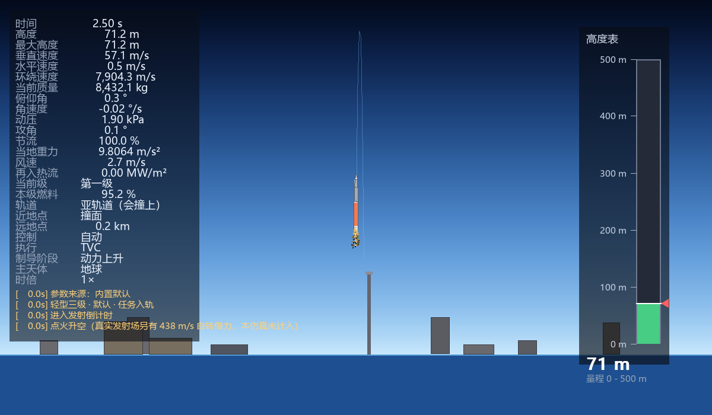
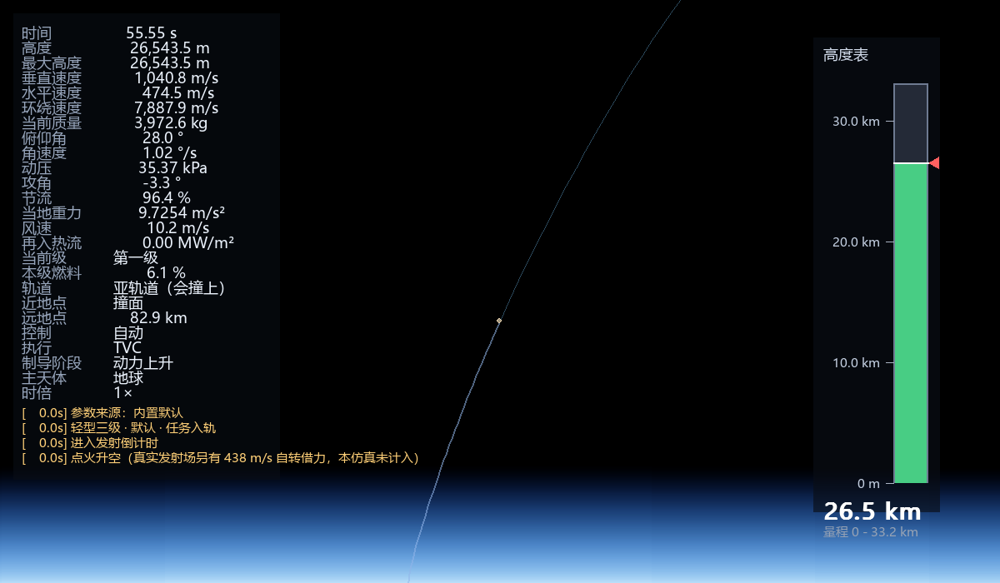
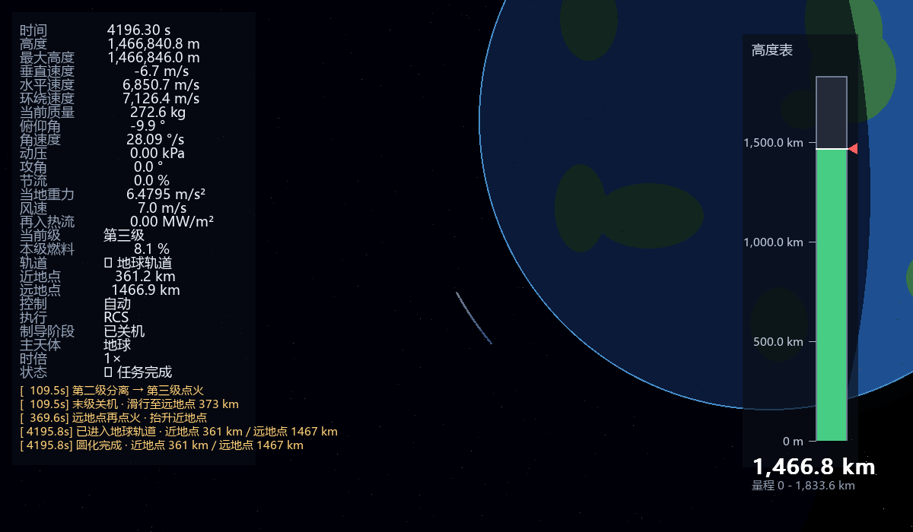
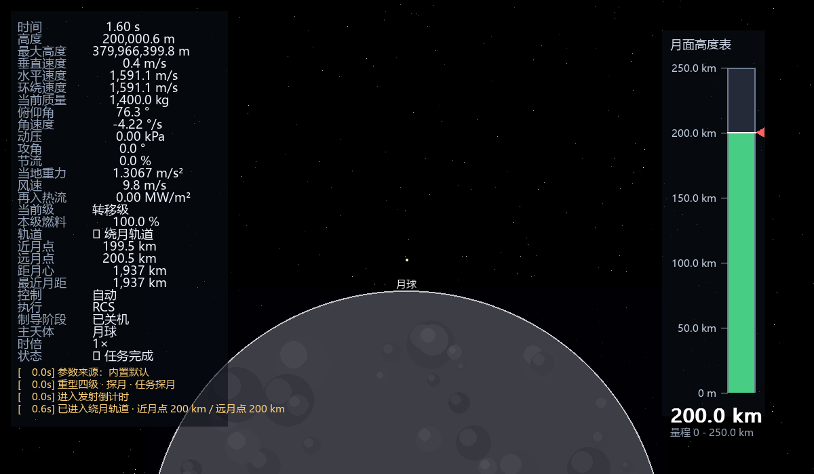

# 三级火箭 / 探月模拟器

[](https://github.com/Avalon-Yin1120/rocket-sim/actions/workflows/ci.yml)


用 Python + pygame 写的二维火箭飞行模拟器：**自己积分轨道力学**（变质量推力、随高度衰减的重力与大气、气动阻力与恢复力矩、摆动发动机 / 侧喷姿态控制），
带一套判据驱动的自动制导，能从发射台一路飞进地球轨道，也能做完整的地月转移并**进入绕月轨道**。

> A 2D rocket-flight simulator in Python + pygame. Orbital mechanics is integrated
> from scratch — variable-mass thrust, altitude-dependent gravity and atmosphere,
> drag plus aerodynamic restoring moment, TVC/RCS attitude control — with a
> criterion-driven autopilot that flies from the pad to low Earth orbit, and
> through trans-lunar injection all the way into **lunar orbit**.
>
> Two bodies (Earth + Moon) with SOI-based primary switching, four built-in
> vehicle presets, and three headless self-check scripts you can run in CI.
> Deep technical write-up: [`docs/DESIGN.md`](docs/DESIGN.md) ·
> post-mortem of the bugs found while rebuilding it: [`docs/REVIEW.md`](docs/REVIEW.md).
> Docs are in Chinese.

| 发射台 | 上升段 |
|---|---|
|  |  |
| 一级点火、塔架与地表；HUD 实时显示攻角、动压、节流与推力矢量 | 最大动压附近；拉远可见地球弧线、大气层与整条上升轨迹 |

| 地球轨道 | 绕月轨道 |
|---|---|
|  |  |
| 制导收工，近地点 361 km / 远地点 1466 km，HUD 显示"已入轨" | 主天体切换为月球，高度表变"月面高度表"，近月点 200 km |

## 特性

- **自写物理**：变质量推力 + Isp 质量流、平方反比重力、指数大气、动压与阻力、
  气动恢复力矩（风标效应）、TVC 摆管 / RCS 侧喷两套姿态执行机构、多级分离与碎片、
  再入热流（Sutton-Graves）与四种失败模式（撞地 / 撞月 / 解体 / 烧毁）。
- **两个主天体**：地球 + 月球（月球按地心匀速圆周给出位置）。月心距进入月球影响球
  就切换主天体，轨道根数、环绕速度、当地重力、高度表、相机取景、任务判据全部跟随。
- **判据驱动的自动制导**：不是硬编码的 `vy` 阈值，而是用开普勒方程算相位、用轨道
  根数判窗口。阶段机：`boost → coast → circ → park → tli → transit → loi → done`。
- **TLI 前向瞄准**：关机判据用"对未来 12 天做前向积分预测出的近月点"，而不是几何
  远地点——这是把"撞月 / 擦肩 25 万公里"的随机性压下去的关键。
- **四套内置火箭**（`P` 键循环切换）：探空 / 轻型三级 / 中型三级 / 重型四级探月。
- **可复现的验证**：三个无头脚本 + CI，改完物理直接看数字，不用靠肉眼。

## 快速开始

```bash
pip install -r requirements.txt
python main.py
```

只要两个第三方包（`pygame-ce`、`pymunk`），其余都是标准库；Python 3.9 以上。
首次运行会自动生成带中文注释的 `rocket_config.json`，之后所有火箭参数都从那里读。

## 按键

| 按键 | 功能 |
|---|---|
| `A` / `D` | 手动姿态（动力段 = TVC 摆管，滑行段 = RCS 侧喷） |
| `W` | 发动机主阀：按一次点火，再按一次关机（**锁存**，不用按住） |
| `Ctrl` | 切换自动 / 手动姿态控制 |
| `M` | 相机自动 / 手动模式 |
| `T` | 显示 / 隐藏 HUD |
| `P` | 换下一枚火箭（循环内置预设） |
| `↑` / `↓` | 时间倍速：1× → 2× → … → 10000× |
| 滚轮 | 缩放 |
| `R` | 重新发射（保留学习进度） |

## 四套内置预设（实测数据）

| 预设 | 起飞质量 | 一级推重比 | 理想 Δv | 实测 Max-Q | 实飞结果 |
|---|---|---|---|---|---|
| `sounding` 探空 2 级 | 1,240 kg | 3.70 | 6,126 m/s | 74.4 kPa | 亚轨道 → 再入 → 撞地（预期的失败演示） |
| `light` 轻型三级 | 8,670 kg | 3.29 | 11,792 m/s | 59.0 kPa | 入轨 361 × 1,706 km |
| `medium` 中型三级 | 93,640 kg | 1.42 | 10,967 m/s | **27.3 kPa** | 入轨 233 × 549 km |
| `lunar` 重型四级 | 50,750 kg | 1.41 | 14,659 m/s | 27.2 kPa | **绕月 19,378 × 21,141 km（e=0.04）** |

`medium` 的 Max-Q 27 kPa 已经落在真实火箭区间（30~35）附近，说明"起飞推重比 1.4 +
真实结构系数"这条重标定路线是有效的；`light` 的 59 kPa 偏高，是推重比 3.3 的直接
后果（默认参数还没重标定，见"已知限制"）。

## 自检工具（无头，不需要显示器）

```bash
python tools/orbit_check.py            # 轨道守恒：圆轨道跑一段，根数必须守恒
python tools/moon_orbit_check.py       # 绕月捕获：构造月球交会，验证近月制动
python tools/flight_test.py            # 整次飞行 + 逐段遥测
python tools/make_screenshots.py       # 无头渲染 docs/images 里的截图

# 常用参数
python tools/flight_test.py --preset lunar --coast-dt 0.5
python tools/flight_test.py --preset medium --v-ref 3200 --csv flight.csv
python tools/moon_orbit_check.py --perilune 2000     # 低月轨捕获
```

最有价值的一条是**绕月捕获自检**：完整的地月转移要飞 5 天、近月点又极敏感，端到端
很难稳定复现；把捕获段单独拿出来测，才能分清"制导写错了"还是"瞄准偏了"。

## 项目结构

```
main.py            主循环、事件、时间倍速与积分预算（每帧最多 400 块）
config.py          地球/月球常数、四套预设、JSON 覆盖逻辑、时间倍速档位
camera.py          自动/手动相机，四段锚点自动取景（贴地 40 px/m ~ 40 万 km 2e-6 px/m）
physics/
  rocket.py        箭体、推进、气动、姿态、多级、轨道根数、全部制导逻辑
  autolearn.py     按预设分开保存的俯仰程序学习表
rendering/         天空、地球、月球、火箭、HUD、高度表、预测轨道、碎片粒子
tools/             三个无头自检脚本 + 截图工具
docs/              DESIGN.md（技术文档）· REVIEW.md（重构复盘）· images/
```

## 文档

- [`docs/DESIGN.md`](docs/DESIGN.md) — 技术文档：物理模型与公式、制导判据、参数含义、
  调参步骤、如何加新的失败模式或新的天体。
- [`docs/REVIEW.md`](docs/REVIEW.md) — 重构复盘：两轮改进里找到的 bug（参考系漂移、
  双曲线 a 设成 inf 导致近月制动永不点火、相位过零检测把 ±π 回绕算成过零……）、
  实测基线与两次自我更正。

## 已知限制

这是**演示级**模拟器，不是工程仿真器。主要缺口（完整清单见 `docs/DESIGN.md`）：

- 默认火箭起飞推重比 3.3（真实 1.3~1.6），实测 Max-Q 59 kPa（真实 30~35）；
- Isp 只用真空值，不随环境气压变化；
- **地球自转没有被真正模拟**，发射场少算约 438 m/s 的自转借力（HUD 里会写明）；
- 1×–100× 走 20 步显式欧拉，与 RK4 两条路径精度都够，但没统一；
- "自动学习"是伪学习：奖励没有真正参与更新，整张俯仰表只乘一个标量；
- 月球运动是给定的（地心匀速圆周、共面、无摄动），不参与动量交换；
- 近月点预测与实况仍有偏差，所以月球任务瞄准的是 15,000 km 远距交会、再靠近月制动
  收圆，中段修正（MCC）还没做。

## 许可

[MIT](LICENSE) © 2026 Avalon-Yin1120
